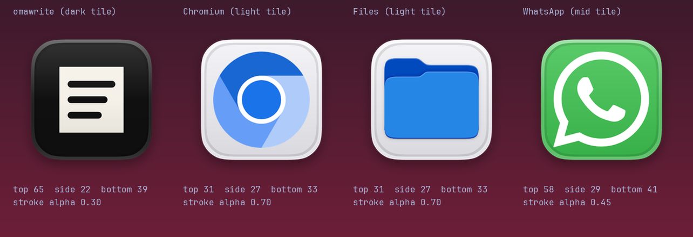

# omarchy-dock

A macOS-style dock for [Omarchy](https://omarchy.org/): always visible on every workspace, squircle tiles with a soft gradient and glass bevel, hover magnification, drag to reorder, pin and unpin by dragging.

It is a shell plugin (`koetsuji.dock`): a rebuilt view on top of the data layer of Omarchy's own `omarchy.dock`. It answers the same IPC target, so `omarchy-shell omarchy.dock apps` and `omarchy dock ...` keep working while the built-in dock is disabled.


## What it does

- **Tiles.** Every app is the same continuous-corner rounded square (Apple's geometry: radius 22.5 %, corner smoothing 60 %) with a gradient, a bevel and a small shadow. Squares fill the tile, other logos sit on a `white`, `brand` or `graphite` tile, picked by contrast rules. Downloads and Trash stay bare. A normalizer (`icons/normalize.py`, Python with Pillow and `rsvg-convert`) bakes each tile once into a cached PNG; the dock only draws images.
- **Hover magnification.** Default 1.4, 1.0 to 2.0 in the settings, applied at once. The row is stretched by one smooth curve around the pointer, so the icon under the pointer stays under it and nothing overlaps or shakes. Only the hover amount is animated.
- **Drag and drop.** Pick an icon up and the others open a gap. Pinned apps reorder freely, running apps that are not pinned can be reordered, dragging one into the pinned section pins it there, dragging a pinned app more than 1.5 icons above the dock (REMOVE) unpins it. Right click cancels.
- **Clicks.** Launch, or focus (current workspace first, then minimized, then elsewhere; repeated clicks cycle windows, most recent first). Middle or Shift+click opens a new window, scrolling cycles windows, right click opens a menu (windows, New Window, the app's own actions, Keep in Dock, Close). The Trash menu empties it behind a confirmation.
- **Windows with no desktop entry** get a designed tile: an agent window (`org.omarchy.agent`) the robot glyph of the agents panel on a tile in the theme accent, other terminals a prompt icon, anything else a window glyph. All three are SVGs in `icons/` that you can edit.
- **Running dots, name labels, a light blur behind the card, a 14 px edge gap like Omarchy's widgets**, and it follows the theme live.


The bevel, 4x: omawrite, Chromium, Files, WhatsApp.



## Requirements

Omarchy with shell plugins (Hyprland, Quickshell). External tools the plugin runs (it installs nothing and uses no elevated privileges): `python3` with Pillow and `rsvg-convert` (to build the tiles), `gio` (to empty the trash), `uwsm-app` and `gtk-launch` (to start apps, as Omarchy's own launcher does), and a Nerd Font (JetBrainsMono Nerd Font) for the prompt and robot glyphs in two icons. Developed against Omarchy 4.0.0 (Hyprland 0.57, Quickshell 0.3, Qt 6.12).

## Install

```bash
omarchy plugin add https://github.com/koetsuji/omarchy-dock --enable
omarchy plugin disable omarchy.dock        # only one dock at a time
```

Your pins stay where Omarchy keeps them (`dock.pinned` in `~/.config/omarchy/shell.json`, managed by `omarchy dock`).

## Remove

```bash
omarchy plugin remove koetsuji.dock --yes
omarchy plugin enable omarchy.dock          # the built-in dock again
```

Removing the plugin leaves your pins alone. Its own files (settings, the tile cache and the optional logs) live in `~/.local/state/omarchy/koetsuji.dock/`; delete that folder to remove them. The plugin never changes any other configuration file.

The first start builds a tile for every installed app in the background (a few seconds to a minute, once). If you want the app grid on a key, bind `omarchy-shell omarchy.dock apps` (Omarchy's default is Super + Alt + Space).

## Settings

`~/.local/state/omarchy/koetsuji.dock/settings.json`, watched live. A missing or broken file falls back to the defaults and logs one warning.

| Key | Default | |
|---|---|---|
| `iconSize` | 56 | Tile size in logical px, 36 to 72. Everything else derives from it. |
| `magnification` | 1.4 | 1.0 (off) to 2.0. |
| `iconStyle` | `squircle` | `squircle` tiles, or `bare` logos straight on the card. |
| `iconCornerRadius` | 0.225 | Fraction of the tile side, 0.18 to 0.24. |
| `cardOpacity` | 0.5 | Card background opacity, 0.2 to 1. |
| `dockBlur` | true | Light blur behind the card. |
| `locked` | false | Turns dragging off. |
| `launchFeedback` | `bounce` | `bounce` or `pulse` while an app starts. |
| `showDownloads`, `showTrash` | true | The two items at the right end. |
| `tileOverrides` | `{}` | App id to `{"mode": "plate" \| "white" \| "brand" \| "graphite", "colors": ["#top", "#bottom"], "logo": 0.4 to 1.2}`. Every key is optional; `logo` scales the logo inside its tile (0.78 gives more padding). |
| `iconOverrides` | `{}` | App id (or `downloads`, `trash`) to an icon name or a file path. |
| `iconScaleOverrides` | `{}` | App id to a size factor, 0.85 to 1.15, for one icon that looks off. |
| `bareItems` | `[]` | App ids drawn as a bare logo, without a tile, even in the squircle style. |
| `slotItems` | `[]` | App ids drawn like Downloads and Trash: the icon fitted to the tile box, no tile (for a folder icon that should look like a folder). |
| `appIdOverrides` | `{}` | Window class to a desktop id, when matching is wrong. |
| `debugEvents` | false | Writes pointer, menu and launch events to `events.log` next to the settings. |

Windows that no desktop entry claims are logged once, by class, to `unmatched.log` there.

## Test hooks

`omarchy-shell omarchy.dock <method>`: `dumpState`, `geometry`, `pin <id>`, `unpin <id>`, `movePinned <from> <to>`, `setSetting <key> <json>`, `activate <id>`, `newWindow <id>`, `cycle <id> <±1>`, `openMenu <id>`, `closeMenu`, `pointer <x>`, `pointerLeave`, `dragStart <id> <x> <y>`, `dragMove`, `dragEnd`, `dragCancel`. `tests/run.sh` uses them to check the dock against `hyprctl clients -j`, the launch of every pinned app, hover, drag and drop, icon metrics and the shell log (about four minutes; it opens a few `foot` test windows and restores your pins, settings and focus). It needs `foot`, `jq`, `grim` and Qt's `qmltestrunner`.

## Notes

- A cloned plugin is not handed the shell's app library (only `menu` plugins are), so `AppLibrary.qml` and `AppSearch.js` are copies of Omarchy's own (MIT), kept so launching works the same way. After an Omarchy update, re-copy them from `shell/services/`.
- `UPSTREAM.md` lists what changed against Omarchy's dock, for merging.
- Not done: the Apps button (removed on purpose), dock positions other than the bottom, auto-hide, resizing by dragging a separator, a dock menu.

## License

MIT, see `LICENSE`. `AppLibrary.qml`, `AppSearch.js`, `AppGrid.qml` and `DockModel.js` derive from Omarchy's shell sources.
