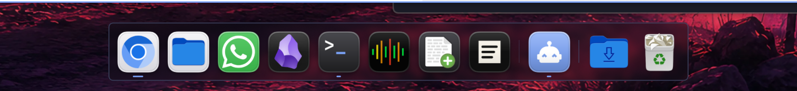
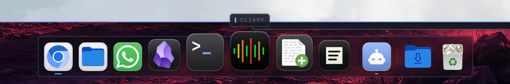
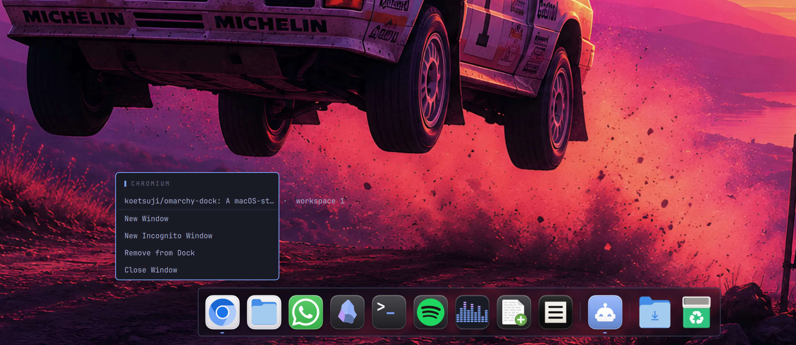
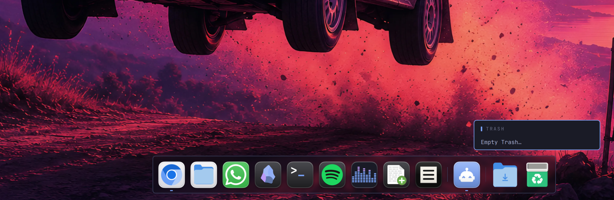

<div align="center">

# Dock

### Your apps deserve a better home.

A dock for [Omarchy](https://omarchy.org/) with the polish of macOS.<br>
Squircle tiles. Glass. Hover magnification. Drag to arrange.

<br>



<br>

<sub>Always visible &nbsp;·&nbsp; Follows your theme &nbsp;·&nbsp; Two commands to install</sub>

</div>

<br>

---

<br>

## Every icon, perfectly at home.

Apps ship icons in every shape: circles, squares, flat logos, half-transparent ghosts. Left alone, a dock full of them looks like a junk drawer.

So every app gets the same tile. A continuous-corner squircle, the real geometry, with a soft gradient, a glass bevel and a gentle shadow. Squares fill it edge to edge. Logos sit on white, brand colour or graphite, whichever reads best. Downloads and Trash stay bare, the way they should.

<div align="center">

</div>

<br>

## Point. Zoom. Click.

Move across the dock and icons swell under your pointer, one smooth curve that pulls their neighbours aside. Nothing overlaps. Nothing shakes. The icon you are aiming at stays exactly where you are aiming.

<div align="center">

</div>

<br>

## A right click that knows your app.

Every window of the app, by title and workspace. New Window. The app's own actions. Keep in Dock. Close.

<div align="center">

</div>

<br>

Trash has its own menu, and **Empty Trash** asks before it does anything.

<div align="center">

</div>

<br>

## Make it yours.

- **Drag to arrange.** Pick an icon up and the others open a gap. Drop it where you want it.
- **Pin by dropping.** Drag a running app into the pinned side to keep it. Drag a pinned app up and away to let it go.
- **Smart clicks.** One click launches or focuses. Click again to cycle the app's windows. Middle click opens a new one. Scroll to flip through them.
- **Unknown windows look intentional.** Agent windows get a robot tile in your accent colour, terminals a prompt, everything else a tidy window glyph.
- **Follows the theme, live.** Change your Omarchy theme and the tiles repaint.

<br>

## Two commands.

```bash
omarchy plugin add https://github.com/koetsuji/omarchy-dock --enable
omarchy plugin disable omarchy.dock        # only one dock at a time
```

Your pins stay exactly where Omarchy keeps them. The first launch bakes a tile for every installed app in the background, a few seconds to a minute, once.

<br>

---

<br>

<div align="center">

# Technical details

*For the curious. Everything below is how it works and how to bend it.*

</div>

<br>

## How it is built

It is a shell plugin (`koetsuji.dock`, kind `service`): a rebuilt view on top of the data layer of Omarchy's own `omarchy.dock`. It answers the same IPC target, so `omarchy-shell omarchy.dock apps` and `omarchy dock ...` keep working while the built-in dock is disabled. Your pins live where Omarchy keeps them (`dock.pinned` in `~/.config/omarchy/shell.json`, managed by `omarchy dock`).

The plugin installs nothing and uses no elevated privileges. It never changes a configuration file other than its own settings.

### The icon pipeline

Icons are not drawn live. `icons/normalize.py` (Python with Pillow and `rsvg-convert`) bakes each tile once into a cached 256 px PNG, and the dock only draws images.

- **Geometry.** Apple's squircle by the figma-squircle path maths: radius 22.5 % of the side, corner smoothing 60 %, mask supersampled 3x. `iconCornerRadius` (0.18 to 0.24) moves the one lever that matters; the curve is fixed.
- **Tile modes.** `plate` (the icon is already a square: frame ring cropped, 3 % overscan, macOS gradient only if its border band is flat), `white`, `graphite`, `brand` (the dominant strong colour, 8 % lighter at the top and 6 % darker at the bottom, near-white parts as a white symbol). Rule order: plate, graphite if mostly light, brand, white, graphite, else white forced. The 3:1 contrast check applies to white and graphite; brand is exempt.
- **Logo fit.** Circles 0.80, squares 0.70, tall 0.62 x 0.80, wide 0.80 x 0.62 of the tile. `tileOverrides.<app>.logo` multiplies that per app (0.4 to 1.2).
- **Finish.** Gradient, 1 px inner edge highlight, a rim chosen from the luminance of a band just inside the tile edge (dark tiles a white rim, light tiles a faint black one), and a soft shadow, all baked into the PNG. Shadow and edge are fractions of the tile, so they scale with `iconSize`.
- **Canvas.** The PNG canvas is 1.30 x the tile, centred, so the shadow reaches past the slot. The slot, and therefore the layout, is the tile.
- **Downloads and Trash** use the `slot` style: the whole icon fitted to 0.92 of the tile side on the tile's baseline.
- **Cache.** `~/.local/state/omarchy/koetsuji.dock/icons/`, keyed by normalizer version, card luminance, options, source path and mtime. Older versions are pruned. The normalizer runs asynchronously (`python3 -B -I`, 30 s timeout) and the dock keeps the last good picture while a new one is made, so a theme change never flashes a raw icon.
- **Source lookup.** The shell hands out `image://icon/NAME` URLs, not paths; the normalizer resolves names itself through the GTK icon theme chain, and renders SVG templates (`%ACCENT%`, `%ACCENT_TOP%`, `%ACCENT_BOTTOM%`) with the theme accent.

### Layout and hover

The row is laid out explicitly: pinned, separator, running, separator, Downloads, Trash. Magnification scales each item by

```
s = 1 + (m - 1) * a * cos(pi/2 * min(1, |d| / R))^2
```

where `m` is `magnification`, `a` the animated hover amount, `d` the item's resting distance from the pointer and `R` three item pitches. Scaled items keep a constant gap, and the row shifts so the resting point under the pointer stays under the pointer (a piecewise-linear map over items and gaps). Only `a` is animated (120 ms OutCubic in, a 60 ms pause then 180 ms OutCubic out); positions never are. With magnification 1.0 or reduced motion, there is no scaling and an accent highlight marks the hovered icon.

The dock reserves its space as a bottom-anchored surface with an exclusive zone (card height plus edge gap, 14 px like Omarchy's widgets). The blur uses `BackgroundEffect.blurRegion`; no Hyprland rule is needed.

### Clicks and menus

- Left click acts on release over the same tile; a move over 8 px cancels it (that is a drag).
- Launch, or focus: the current workspace first, then minimised windows, then other workspaces. Repeated clicks cycle windows, most recent first, from activation stamps taken from `activewindowv2` events.
- Middle or Shift+click opens a new window; scrolling cycles windows (one step per 200 ms).
- Launching uses `uwsm-app -- gtk-launch <id>.desktop` (`omarchy-launch-tui` for terminal entries), like Omarchy's own launcher. A launch that shows no window within 10 s stops its feedback and is logged.
- Menus use the shell's `BorderSurface` and `PopupMenuRow`, one at a time. They close on an outside click (`HyprlandFocusGrab`), on Escape, or when the app disappears. Keyboard focus is exclusive only while a menu is open.
- Downloads opens the folder from `user-dirs.dirs` (falling back to `~/Downloads`) and Trash opens `~/.local/share/Trash/files`, both through `xdg-open`. Emptying uses `gio trash --empty`.
- Window classes that no desktop entry claims become an item keyed by their class, logged once to `unmatched.log`. `appIdOverrides` fixes a wrong match.

### Requirements

Omarchy with shell plugins (Hyprland, Quickshell). External tools the plugin runs: `python3` with Pillow and `rsvg-convert` (tiles), `gio` (emptying the trash), `xdg-open`, `uwsm-app` and `gtk-launch` (starting apps), and a Nerd Font (JetBrainsMono Nerd Font) for the prompt and robot glyphs in two icons. Developed against Omarchy 4.0.0 (Hyprland 0.57, Quickshell 0.3, Qt 6.12).

## Settings

`~/.local/state/omarchy/koetsuji.dock/settings.json`, watched live. A missing or broken file falls back to the defaults and logs one warning.

| Key | Default | |
|---|---|---|
| `iconSize` | 56 | Tile size in logical px, 36 to 72. Everything else derives from it. |
| `magnification` | 1.4 | 1.0 (off) to 2.0. |
| `iconStyle` | `squircle` | `squircle` tiles, or `bare` logos straight on the card. |
| `iconCornerRadius` | 0.225 | Fraction of the tile side, 0.18 to 0.24. |
| `cardOpacity` | 0.5 | Card background opacity, 0.2 to 1. |
| `dockBlur` | true | Light blur behind the card. |
| `locked` | false | Turns dragging off. |
| `launchFeedback` | `bounce` | `bounce` or `pulse` while an app starts. |
| `showDownloads`, `showTrash` | true | The two items at the right end. |
| `tileOverrides` | `{}` | App id to `{"mode": "plate" \| "white" \| "brand" \| "graphite", "colors": ["#top", "#bottom"], "logo": 0.4 to 1.2}`. Every key is optional; `logo` scales the logo inside its tile (0.78 gives more padding). |
| `iconOverrides` | `{}` | App id (or `downloads`, `trash`) to an icon name or a file path. |
| `iconScaleOverrides` | `{}` | App id to a size factor, 0.85 to 1.15, for one icon that looks off. |
| `bareItems` | `[]` | App ids drawn as a bare logo, without a tile, even in the squircle style. |
| `slotItems` | `[]` | App ids drawn like Downloads and Trash: the icon fitted to the tile box, no tile. |
| `appIdOverrides` | `{}` | Window class to a desktop id, when matching is wrong. |
| `debugEvents` | false | Writes pointer, menu and launch events to `events.log` next to the settings. |

If you want the app grid on a key, bind `omarchy-shell omarchy.dock apps` (Omarchy's default is Super + Alt + Space).

## Test hooks

`omarchy-shell omarchy.dock <method>`: `dumpState`, `geometry`, `pin <id>`, `unpin <id>`, `movePinned <from> <to>`, `setSetting <key> <json>`, `activate <id>`, `newWindow <id>`, `cycle <id> <±1>`, `openMenu <id>`, `closeMenu`, `pointer <x>`, `pointerLeave`, `dragStart <id> <x> <y>`, `dragMove`, `dragEnd`, `dragCancel`.

`tests/run.sh` uses them to check the dock against `hyprctl clients -j`, the launch of every pinned app, hover, drag and drop, icon metrics and the shell log (about four minutes; it opens a few `foot` test windows and restores your pins, settings and focus). It needs `foot`, `jq`, `grim` and Qt's `qmltestrunner`. `geometry` returns, per monitor, the card, every item's slot, canvas and drawn tile size, which is how the tile sizes are measured.

## Remove

```bash
omarchy plugin remove koetsuji.dock --yes
omarchy plugin enable omarchy.dock          # the built-in dock again
```

Removing the plugin leaves your pins alone. Its own files (settings, the tile cache and the optional logs) live in `~/.local/state/omarchy/koetsuji.dock/`; delete that folder to remove them.

## Notes

- A cloned plugin is not handed the shell's app library (only `menu` plugins are), so `AppLibrary.qml` and `AppSearch.js` are copies of Omarchy's own (MIT), kept so launching works the same way. After an Omarchy update, re-copy them from `shell/services/`.
- `UPSTREAM.md` lists what changed against Omarchy's dock, for merging.
- Not done: the Apps button (removed on purpose), dock positions other than the bottom, auto-hide, resizing by dragging a separator, a menu on the dock itself.

## License

MIT, see `LICENSE`. `AppLibrary.qml`, `AppSearch.js`, `AppGrid.qml` and `DockModel.js` derive from Omarchy's shell sources.
